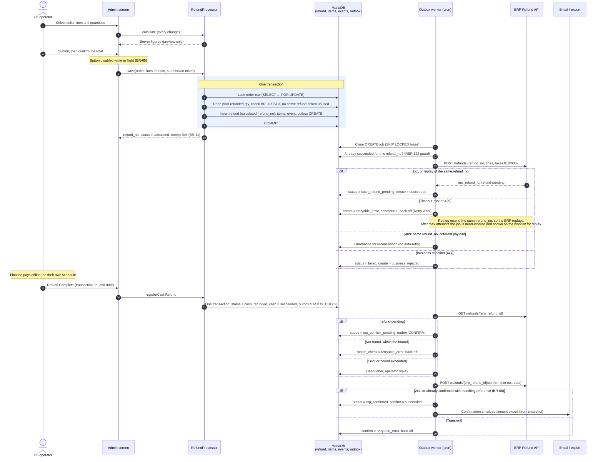
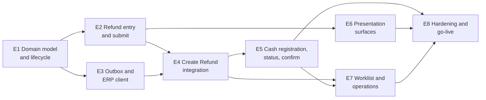

# 02 - Refund Design

## Design principles

Six rules shape everything below. Each comes straight from the FRD.

1. **Commit, then notify (BR-06).** No HTTP call happens inside a database transaction or inside an operator's request. The refund, its items, its first audit event and its first outbox job commit together; a worker makes the ERP call afterwards.
2. **One stable key per external action (BR-07, BR-08).** Create always sends the stored `refund_no`; Confirm always uses `erp_refund_id`. Attempt numbers are for tracing only.
3. **Transient errors never move the main status (§7, §9.6).** Timeouts, 5xx and 429 update a sub-status, record an attempt and back off. Only a definitive business rejection reaches `failed`.
4. **One calculation, five surfaces (§10.4).** Every amount is computed once into the stored snapshot. The receipt, order details, order history, email and export all read that snapshot.
5. **The server owns state (§14).** The browser shows only what the server returned.
6. **Built to scale out, not up.** Every step after submit is idempotent, keyed, and claimed with `SKIP LOCKED`, so more workers add throughput without coordination; no step holds a lock while waiting on the network. Capacity and bottlenecks are in `03`.

## Decisions on conflicting requirements

The FRD contradicts itself in four places. The design needs an answer to each; all four are also open questions in `06`.

| Conflict | Decision in this design | Why |
| --- | --- | --- |
| BR-02 says 14 days from delivery; the contract note says 7 days from receipt and "must not be overridden". | Window length is configuration (`acme_seller_refund/general/window_days`), default **14** as `main` ships. Not overridable by CS. | Configuration lets the business switch to 7 without a release. The contract is the stronger source, so this is the first question to settle. |
| §2 / BR-07: the store allocates `refund_no`. §9.5: the ERP allocates it. | **The store allocates it** at record creation. Any ERP number is stored as `erp_refund_id`. | An ERP-allocated number cannot be the key for the very first Create, which is the call that can time out after acceptance. |
| §4: the status read is per refund, on demand, by the operator. §9.2: a scheduled batch sweep. | **Both, through one path.** Refund Complete enqueues the status check for that refund straight away; a bounded sweep re-enqueues anything left in `cash_refunded` with no live job. | The operator gets a prompt result; nothing depends on someone remembering to come back. |
| BR-09: a submitted refund cannot be cancelled. §7 and the ACL have `cancelled`. | `cancelled` only from `calculated` while `create_status` is `not_started` or `business_rejected`, i.e. before any credit note exists. | Cancelling after the ERP opened a credit note would leave an orphan credit note and free the quantity for a second refund. |

§9.4 (Settlement Adjustment Export as "the authoritative record that the refund has settled") also overlaps with §9.3 (`erp_confirmed` as terminal). I treat `erp_confirmed` as the lifecycle end and the export as a downstream consumer of the same snapshot, and list it as a question.

## End-to-end sequence

### Failure boundaries the diagram is built around

| Boundary | What can go wrong | How the design survives it |
| --- | --- | --- |
| Before COMMIT | Validation fails, a lock wait times out, the process dies | Everything rolls back. No ERP call has been made. |
| COMMIT → ERP accepts | Worker dies after the ERP accepted but before the local write | The job's lease expires; the retry sends the same `refund_no`; the ERP replays the original `erp_refund_id`. |
| ERP response lost (timeout after accept) | Local record shows `retryable_error` while the ERP has the credit note | Same as above. The local "already succeeded" check covers the case where the local write landed but the job was not marked done. |
| Browser retry after a timeout | Operator presses again or the browser resubmits | Button disabled in flight; a submission token stored with the refund makes a repeat return the existing refund, not a new one. |
| Two operators, same order | Both read the same remaining quantity | The order-row lock serialises them; the second re-reads prior quantities and is refused if nothing remains. |
| ERP down for hours | Jobs keep failing | Exponential backoff to a cap, then dead-letter. The worklist shows the backlog; an operator with retry permission replays it. No database editing. |
| Status read: not found | ERP eventual consistency right after Create | Retried within a configured bound (§9.2), then dead-lettered. |
| Email / export failure | SMTP or export failure after `erp_confirmed` | Logged and retried separately; never rolls back a confirmed financial state. |

## Integration resilience: queues, retry, dead letters, alerts and logging

Every ERP call is asynchronous work with a visible life: queued, retried with backoff, either succeeded or dead-lettered, and visible to an operator who can replay it. This is the same webhook → queue → persisted log → retry cron → alert pattern I used for third-party integrations on a multi-store grocery platform, adapted to this runtime.

**What the FRD requires and what I add.** Bounded automated retry, a dead letter, an authorised replay path, visible attempt history and distinguishable error classes are required (§9, §9.6, §12.2). Alert emails, admin-configurable schedules, a technical log channel and a dedicated queue grid are my production proposals, marked *(proposal)* below; they make the required behaviour operable at volume. How the flow scales beyond the FRD's volumes is in `03`, "Scaling to high volume".

### Transport: a transactional outbox, not a broker

The runtime has no message broker (brief, technical baseline), and BR-06 needs the refund and its first job to commit together. So the queue is the `mp_refund_outbox` table, written in the same transaction as the refund. A queue state is a row state:

| Queue | Row state | Meaning |
| --- | --- | --- |
| Active | `pending`, `available_at <= NOW()` | Ready to be claimed by a worker (`SELECT … FOR UPDATE SKIP LOCKED` lease) |
| Retry | `pending`, `available_at` in the future | Waiting out its backoff after a transient failure |
| Dead letter | `dead` | Retry limit reached, or a non-retriable error; waits for an operator |
| Done | `done` / `cancelled` | Finished; kept for audit |

**At production scale** the guarantees stay the same and only the transport changes: a relay publishes outbox rows to a broker (for example RabbitMQ through Magento's `queue_topology.xml`), with a work queue, delayed retry queues (TTL plus dead-letter exchange back to work) and a dead-letter queue. Durable queues, persistent messages, publisher confirms and manual acknowledgement after the outcome is recorded. Idempotency keys (`refund_no`, `erp_refund_id`) make broker redelivery harmless.

### Retry policy, configured by the admin

A cron job (`acme_refund_outbox_work`) claims due jobs in bounded batches. Its schedule and limits live in **Stores → Configuration → Seller Refund → ERP Refund API**, so operations can tune them without a release:

| Setting | Default | Purpose | Today |
| --- | --- | --- | --- |
| Worker schedule (cron expression) | `* * * * *` (every minute) | How often the outbox worker runs | Fixed in `crontab.xml`; make configurable |
| Reconciler schedule | `*/15 * * * *` | Safety-net sweep for refunds in `cash_refunded` | Fixed in `crontab.xml`; make configurable |
| Alert digest schedule | `*/15 * * * *` | How often dead-letter and stale-queue emails are sent | New |
| Max attempts | 8 | After this many failures the job is dead-lettered | In the admin (`system.xml`) |
| Backoff base / cap (seconds) | 5 / 300 | Delay = min(cap, base^attempt), plus jitter; `Retry-After` from a 429 is honoured | In the admin (`system.xml`); jitter not yet added |
| Connect / read timeout (seconds) | 2 / 3 | No worker waits long on one call | In the admin (`system.xml`) |
| Batch size per run | 50 | Bounds each cron run | Hard-coded; make configurable |
| Alert recipients, sender, stale threshold | — | Who is emailed, and when (below) | New |

**How the schedules become configurable (standard Magento).** Each job in `etc/crontab.xml` uses `<config_path>` instead of a fixed `<schedule>`, for example `<config_path>acme_seller_refund/cron/outbox_work_expr</config_path>`, so Magento's cron reads the expression from configuration. The `system.xml` field for each schedule uses a backend model that rejects an invalid cron expression before saving, and `etc/config.xml` keeps the defaults above, so a fresh install behaves exactly as today. A schedule change takes effect when the cron group next generates its schedule; no deployment or cache flush is needed beyond saving the configuration.

### Error classification decides retry or dead letter

| Error type | Examples | Action |
| --- | --- | --- |
| `transient` | Timeout, connection refused, 5xx | Retry with backoff |
| `rate_limit` | 429 | Retry after `Retry-After` |
| `business` | 422 rejection | No retry; refund `failed`; event logged |
| `conflict` | 409, same key with a different payload | No retry; refund held for reconciliation |
| `poison` | Payload cannot be built, mandatory data missing | Straight to the dead letter; never retried |

The type is stored on the job (`error_type`) next to `attempts` and `last_error`, so the grid can filter by it.

### Failure email *(proposal)*

- **Dead-letter alert:** when a job is dead-lettered, an email goes to the configured recipients with the refund number, operation, error type, last error and a link to the refund. A digest cron (every 15 minutes) batches these, so an ERP outage sends one email, not hundreds.
- **Stale-queue alert:** if the oldest due job is older than a threshold (default 15 minutes), the cron emails the same recipients. This catches the case where the worker itself has stopped, which no per-job error can report.
- Sent through Magento's transport with a configurable sender identity and template; a failed alert email is logged and never affects the refund.

### Logging: two layers, kept separate *(audit layer required by §12.4; technical channel is a proposal)*

| Layer | Where | Content | Audience |
| --- | --- | --- | --- |
| Business audit | `mp_refund_event` (append-only, §6) | Every state change and API call, redacted request and response, `attempt_no`, actor | Operators, Finance, auditors |
| Technical log | Dedicated Monolog channel, `var/log/acme_seller_refund.log` | Structured context on every call: `refund_no`, operation, attempt, `X-Request-Id`, HTTP status, latency, error type | Developers, support |

Both carry `refund_no` as the correlation ID, so one search finds a refund's whole history. Neither stores credentials, bank details beyond the transaction reference, or unneeded personal data (§12.4).

### Admin grid: Integration Queue *(proposal; §10.2 requires integration state on the worklist)*

A grid under **Sales → Seller Refunds → Integration Queue**, built as a standard admin listing:

- **Columns:** refund number (links to the refund), operation, queue state, attempts / max, error type, last error, next attempt at, updated at.
- **Filters:** state (retry / dead / done), operation, error type, date range.
- **Mass actions:** *Replay* (ACL `Acme_SellerRefund::retry`): re-queues dead jobs with attempts reset, and is recorded as a `replay` event with the actor. *Mark resolved* (ACL `Acme_SellerRefund::audit`): closes a dead job that was fixed outside the system, with a mandatory note.
- **Error log view:** the `mp_refund_event` rows with an error status, filterable by refund and error type; raw payloads only for the audit ACL.
- When a replay succeeds, older dead jobs for the same refund and operation are marked resolved automatically, so the grid shows only what still needs attention.

### What exists today and what is new

| Capability | In the module now | Added by this design |
| --- | --- | --- |
| Transactional outbox, leased claims, backoff | ✅ `Outbox`, `Dispatcher`, `BackoffPolicy` | Jitter |
| Retry limit from admin config | ✅ `max_attempts`, backoff and timeouts in `system.xml` | Cron schedules, batch size and alert settings in the admin |
| Dead letter | ✅ `dead` state; reconciler no longer re-queues it; Needs Attention column on the grid | Auto-resolve on successful replay |
| Error classification | Partly (exception classes) | `error_type` column; poison → dead letter |
| Replay | ✅ per refund, from the refund page | Mass replay and *Mark resolved* in the grid |
| Failure email | — | Dead-letter digest and stale-queue alert |
| Technical log channel | — | Dedicated Monolog channel with correlation ID |
| Integration Queue grid | — | New |

## Phased delivery plan

Epic granularity. Each phase ends at an acceptance gate; nothing in a later phase starts until the gate it depends on has passed.

| Phase | Epic | Scope | Acceptance gate |
| --- | --- | --- | --- |
| 1. Foundation | **E1 Domain model and lifecycle** | Schema (`mp_refund`, items, events, outbox, sequence), `refund_no` allocation, state machine with optimistic locking on `version`, ACL resources. | Every illegal transition is rejected in unit tests. Concurrent `refund_no` allocation produces no duplicates. |
| | **E3 Outbox and ERP client** | DB outbox with leased claims, backoff and dead-letter; admin-configurable cron schedules and retry limits; ERP client with bounded connect/read timeouts and an error taxonomy (transient, rate limit, conflict, business, poison); technical log channel with `refund_no` as correlation ID. | Each stub failure mode maps to the right exception class. A worker killed mid-job leaves the job re-claimable. |
| 2. Core flow | **E2 Refund entry and submit** | Eligibility (BR-01/02), server-side calculation (§11), quantity guard under the order lock (BR-03), one active refund and the submission token (BR-05), the confirmation dialog. | Parallel-submit test: N concurrent submissions on one order never exceed the remaining quantity. Mixed order refunds seller lines only. |
| | **E4 Create Refund integration** | CREATE job, stable `refund_no`, REF-142 guard, mapping of the 2xx/409/4xx/5xx/429/timeout outcomes. | Stub `timeout_after_accept`: exactly one credit note and the original `erp_refund_id`. A 503 leaves the refund at `calculated`. Business-code tax values (`010`/`008`). |
| 3. Settlement | **E5 Cash registration, status, confirm** | Refund Complete action (transaction no. and date), status check via the outbox plus the safety-net sweep, Confirm with BR-08 matching, confirmation email trigger. | Full lifecycle to `erp_confirmed` against the stub, including `delayed_status` and `already_confirmed`. Confirm cannot run before cash registration (BR-10). |
| | **E6 Presentation surfaces** | One figures object from the snapshot feeding the receipt PDF, order details, history, email and export; partial-refund labelling. | One acceptance test renders all five surfaces for a pure-seller and a mixed order and asserts identical figures. Tax review of the receipt as a qualified invoice. |
| 4. Operations | **E7 Worklist and operations** | Paginated, joined worklist with filters; Integration Queue grid (retry count, dead letters, error type, mass replay, mark resolved); error log view; dead-letter digest and stale-queue alert emails; audit view gated by ACL. | First page within 1.5 s at 12 months of volume (~60k refunds) with 40 concurrent users. Stub outage drill: jobs back off, dead-letter at the configured limit, one digest email arrives, mass replay recovers them. No recovery path needs SQL. |
| 5. Release | **E8 Hardening and go-live** | Payload redaction (§12.4), metrics and alerts (outbox depth, oldest job age, dead letters), runbook, data migration if any, reconciliation report (local vs ERP). | Load test at 25 submissions/minute with ERP latency injected. Reconciliation of a full test day shows zero unmatched credit notes. Sign-off by CS, Finance and Tax. |

**Critical path:** E1 → E3 → E4 → E5 → E8. E6 can start once E2 fixes the snapshot shape, and runs in parallel with the integration work.

**Where I bounded this:** no estimates, no sprint split, and no design for the downstream core-system export beyond "reads the same snapshot", because its contract is not in the FRD.
